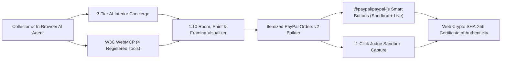

# Agentic Interior Art Concierge & PayPal Orders v2 Atelier

[](./LICENSE)
[](https://developer.paypal.com/docs/api/orders/v2/)
[](./schema.json)

> **Built for the [2026 PayPal AI Hackathon](https://paypalaihackathon.devpost.com/) ("Build What's Next with PayPal and AI")**
>
> - **Live Functional Demo**: **https://philgear.github.io/pgphototrek-paypal-ai/**
> - **Production Store Origin**: [philgearphotography.com/store](https://www.philgearphotography.com/store)
> - **Open-Source License**: [Apache-2.0](./LICENSE)

---

## What Problem Does This Solve?

Buying large-format fine art online has a **72% cart abandonment rate** because collectors face three compounding anxieties:
1. **Scale & Lighting Uncertainty**: *"Will a 24×36\" acrylic print overwhelm my credenza or clash with my wall paint?"*
2. **Opaque Framing & Rebate Pricing**: Custom framing addons, substrate multipliers, and local studio pickup rebates rarely reconcile cleanly at checkout.
3. **The Agentic Commerce Gap**: AI assistants can recommend art in chat, yet hit a wall when trying to stage an actual architectural room, calculate itemized framing math, and hand off a verified **PayPal Orders v2** checkout without taking unauthorized payment actions.

**Phil Gear Photography's Agentic Atelier** solves all three in a single cohesive web application combining a **1:10 Architectural Room Visualizer**, a **3-Tier AI Interior Art Concierge**, **W3C WebMCP (`document.modelContext`)** in-browser agent tools, and **PayPal Orders v2 Smart Payment Buttons** paired with **Web Crypto SHA-256 Provenance Certificates**.

---

## Architecture Overview



---

## Core Capabilities

### 1. PayPal Developer Platform Integration (`src/lib/paypal-orders.ts`)
- **Official `@paypal/paypal-js` v8 SDK**: Dynamically mounts PayPal & Venmo Smart Payment Buttons (`intent: "CAPTURE"`).
- **Strict Itemized Orders v2 Breakdown**: Every dimension (`16×24"`, `24×36"`, `40×60"`), archival medium (*Museo Giclée*, *ChromaLuxe Brushed Metal*, *TruLife Acrylic*), custom Portland framing profile (*Beard's Framing*, *PDX Winter Light Luminescent*, *Goodwill Upcycle*), and studio rebate (`-$35` to `-$50`) compiles into a real-time `/v2/checkout/orders` JSON ledger where `item_total - discount === value` to the cent.
- **Dual Sandbox + Live Toggle & Zero-Friction Judge Simulator**:
  - Defaults to **PayPal Sandbox SDK (`client-id=sb`)** so any judge with a PayPal Developer Sandbox buyer account can test live popup order creation & capture.
  - Includes a **Live Merchant SDK toggle** connected to Phil Gear Photography's verified merchant client ID.
  - Includes a **1-Click Judge Sandbox Order v2 Capture** button so judges without a Sandbox login at hand can still inspect the full post-capture receipt and **Web Crypto `SHA-256` Certificate of Authenticity (`/certificate/`)** in seconds.

### 2. Multi-Tier AI Interior Art Concierge (`src/lib/ai-concierge.ts`)
Accepts natural-language architectural briefs with hard dollar caps—e.g., *"Dramatic misty Pacific Northwest forest for a dark walnut executive office under $750"*—and cascades gracefully across three AI engines:
1. **Tier 1 — Google Gemini (`gemini-3.8-flash`)**: Structured JSON schema curation when an optional Gemini API key is pasted into the Concierge bar.
2. **Tier 2 — Chrome Built-in AI (`window.ai.languageModel` / Gemma 4)**: Zero-egress on-device LLM inference when available in Chrome.
3. **Tier 3 — Deterministic 256-Dim N-Gram Vector Ranker & Budget Solver**: Embedded directly in TypeScript (`embedText256d` + cosine similarity + architectural room/paint/substrate budget solver) so **every judge gets instant, deterministic AI staging with zero API keys required**.

### 3. W3C WebMCP Agentic Commerce (`src/lib/webmcp-store-tools.ts`, `schema.json`, `evals.json`)
Exposes **4 client-side tools** on `document.modelContext` (plus an interactive **Judge Agentic Inspector HUD** right on the page for 1-click testing in any browser):

| Tool Name | Mode | Purpose |
| :--- | :--- | :--- |
| `search_fine_art_prints` | `readOnlyHint: true` | Semantic search across 36 curated prints with domain filters & compact pagination (`<= 1,500` chars). |
| `stage_artwork_in_room` | UI Mutation | Mounts a print into the 1:10 room scene, applies calibrated Rodda/Miller/Sherwin-Williams wall paint, and updates framing. |
| `curate_room_with_ai` | AI + UI Mutation | Runs the multi-tier AI Concierge against room/color/budget constraints and stages the winning configuration. |
| `initiate_paypal_checkout` | Human-in-the-Loop | Verifies the itemized PayPal Orders v2 payload and focuses the PayPal Smart Buttons—never auto-capturing funds without explicit user approval. |

---

## Quick Start (Local Build & Run Instructions for Judges)

**Prerequisites**: Node.js `>= 22.0.0` and `npm`. Zero API keys or `.env` files are required!

```bash
# 1. Clone the repository
git clone https://github.com/philgear/pgphototrek-paypal-ai.git
cd pgphototrek-paypal-ai

# 2. Install dependencies
npm install

# 3. Run the Vitest unit test suite (PayPal Orders v2 math, AI Concierge budget solver, WebMCP tools)
npm test

# 4. Launch the interactive local dev server (http://localhost:4321)
npm run dev
```

To build the static production bundle:

```bash
npm run check
npm run build
npm run preview
```

---

## Repository Structure

```text
pgphototrek-paypal-ai/
├── src/
│   ├── data/store-catalog.json      # 36 curated fine art plates + calibrated architectural paint palettes
│   ├── layouts/StoreLayout.astro    # Responsive shell, PocketGull WOFF2 typography, theme switcher
│   ├── lib/
│   │   ├── ai-concierge.ts          # 3-tier AI Concierge (Gemini 3.8 Flash -> Chrome Gemma 4 -> 256-d Vector Solver)
│   │   ├── paypal-orders.ts         # @paypal/paypal-js Orders v2 builder, Smart Buttons & SHA-256 COA engine
│   │   └── webmcp-store-tools.ts    # W3C WebMCP document.modelContext 4-tool registration
│   ├── pages/
│   │   ├── index.astro              # Primary 1:10 Visualizer, AI Concierge, PayPal Ledger & WebMCP Inspector
│   │   ├── success.astro            # Post-capture PayPal Orders v2 settlement confirmation
│   │   ├── certificate.astro        # Print-ready 1-of-1 SHA-256 Certificate of Authenticity
│   │   └── cancel.astro             # Graceful checkout pause & return flow
│   └── scripts/store-client.ts      # Client state orchestration
├── tests/store-ai-paypal.spec.ts    # Automated unit & integration specs (Vitest + JSDOM)
├── schema.json                      # W3C WebMCP JSON Schema manifest
├── evals.json                       # Agentic tool-selection evaluation suite
├── public/llms.txt                  # AI agent capability discovery manifest
└── LICENSE                          # Apache-2.0 Open Source License
```

---

## License

Code is licensed under the **[Apache License 2.0](./LICENSE)**. Fine art photographic plates © Phil Gear Photography — included for interactive viewing, staging, and PayPal AI Hackathon evaluation.
